# Tunnelbox — user manual

*🇬🇧 English · [🇵🇱 Polski](MANUAL.pl.md)*

A complete step-by-step guide with screenshots. You do not need to know anything about
networks or the command line — everything is done in the browser.

**What does this program do?** It connects you to a client's network over a Fortinet VPN
(SSL-VPN or IPsec) and creates local "shortcuts" to machines in that network. Instead of the
real address (say `10.10.10.11`) you type a simple one like `127.0.0.2:13391` into your remote
desktop or SSH client. The VPN itself runs in the background, inside an isolated Docker
container — your own computer is never wired into the client's network.

Tunnelbox is the new name of FortiVPN 2 (since version 3.0.0) and is not affiliated with or
endorsed by Fortinet.

---

## Table of contents
1. [What you need](#1-what-you-need)
2. [Installing and starting](#2-installing-and-starting)
3. [Step 1 — set a master password](#3-step-1--set-a-master-password)
4. [Step 2 — unlock the panel](#4-step-2--unlock-the-panel)
5. [Step 3 — the empty panel](#5-step-3--the-empty-panel)
6. [Step 4 — add a connection](#6-step-4--add-a-connection)
7. [Step 5 — connect](#7-step-5--connect)
8. [Step 6 — unknown certificate](#8-step-6--unknown-certificate)
9. [Step 7 — use the connection](#9-step-7--use-the-connection)
10. [Several connections at once](#10-several-connections-at-once)
11. [Disconnecting and locking the panel](#11-disconnecting-and-locking-the-panel)
12. [Panel settings](#12-panel-settings)
13. [Statuses and troubleshooting](#13-statuses-and-troubleshooting)
14. [Security and backup](#14-security-and-backup)
15. [Updates](#15-updates)

---

## 1. What you need

- **Docker Desktop** — the only program you have to install.
  Get it from [docker.com](https://www.docker.com/products/docker-desktop/), install it
  and start it (wait until the whale icon in the tray stops animating). On Linux, Docker
  Engine is enough.
- Credentials for the client's VPN (server address, username, password) — you get them
  from the client or their administrator.

Nothing else is needed — no Python, no OpenSSL, no console.

> 🌍 **The panel starts in English.** Polish is one setting away:
> **⚙ Settings → Language → Polski**. The choice covers the whole interface, including
> messages coming from connections, and is saved with your configuration (see
> [Panel settings](#12-panel-settings)).

---

## 2. Installing and starting

1. Download the latest package, **`tunnelbox-X.Y.Z.zip`**, from the
   [project page](https://mysttic.github.io/Mysttic/tunnelbox/) and unpack it into any
   folder.
2. Make sure **Docker Desktop is running**.
3. In the program folder, double-click **`start.bat`** (Windows). On Mac/Linux run
   `./start.sh` — on a Mac it asks for your password once to add the local addresses the
   panel needs (they disappear after a reboot, so run `./start.sh` again then).
4. The first run loads the bundled image into Docker and can take a few minutes (later
   runs are instant — the image is already there). Nothing is built and nothing is
   downloaded from the internet. At the end the panel opens by itself in your browser at
   **http://tunnelbox.localhost:25263**.

The panel runs in the background — you do not have to keep a console window open. You can
reopen it at any time by typing `tunnelbox.localhost:25263` in your browser.

**Had FortiVPN 2 before?** Tunnelbox is its new name, but it installs from scratch and
does not take over FortiVPN 2. To bring your saved connections along:

1. In FortiVPN 2: **⚙ Settings → "⬇️ Export configuration"** (the file is encrypted with
   your master password).
2. Remove FortiVPN 2's container, which holds the panel's port: in Docker Desktop →
   **Containers** delete `fortivpn2-panel` (or run `docker rm -f fortivpn2-panel`).
3. Install Tunnelbox as above.
4. On the first screen click **"⬆️ Import"**, pick the exported file and type the same
   master password.

FortiVPN 2 already gone? Import its vault file instead:
`%LOCALAPPDATA%\FortiVPN2\data\vault.enc` (Mac/Linux:
`~/.local/share/fortivpn2/data/vault.enc`). Once everything works, delete the
`%LOCALAPPDATA%\FortiVPN2` folder (Mac/Linux: `~/.local/share/fortivpn2`) and the old
`fortivpn2-panel` images in Docker Desktop → **Images**. Update your bookmark too: the panel
now opens at **http://tunnelbox.localhost:25263**.

---

## 3. Step 1 — set a master password

On the first run the program asks for a **master password**. That one password encrypts
all your connections (addresses, usernames, VPN passwords). Without it, nobody can read
them off the disk.

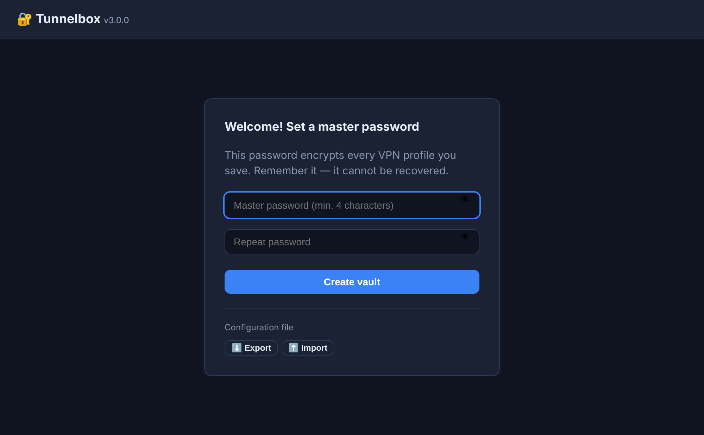

- Type the password (at least 4 characters) and repeat it in the second field.
- Click **Create vault** — that's it.
- The 👁 icon on the right of the field shows what you are typing, to avoid a typo.

> ⚠️ **Remember this password.** It cannot be recovered or reset. If you forget it, the
> only way forward is to create the vault from scratch (losing your saved connections).

---

## 4. Step 2 — unlock the panel

Every time you open the panel again (or after clicking "Lock panel") you get the unlock
screen. Type the master password and click **Unlock**.

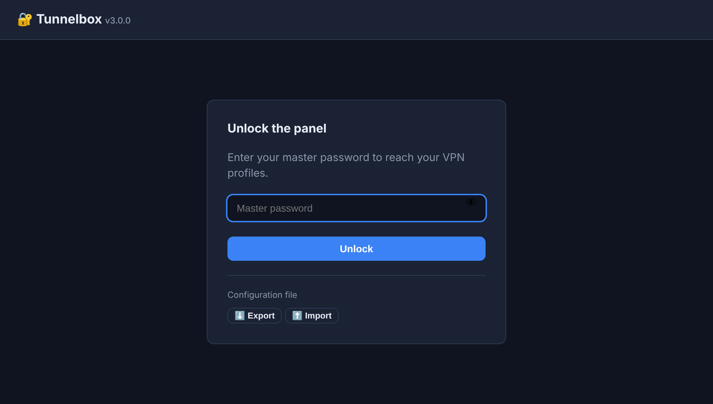

---

## 5. Step 3 — the empty panel

Once unlocked, with no connections yet, the panel looks like this:

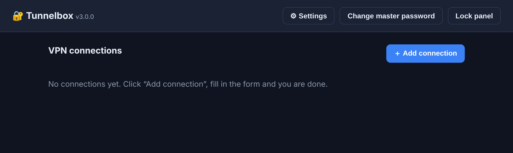

Click **＋ Add connection** in the top right to create your first one.

In the header, next to the program name, you see the **installed version number** (e.g.
`v3.0.0`) — useful when reporting a problem or checking whether you have the latest one
([Updates](#15-updates)). On the right there are three buttons: **⚙ Settings**
([section 12](#12-panel-settings)), **Change master password** and **Lock panel**
([section 11](#11-disconnecting-and-locking-the-panel)).

---

## 6. Step 4 — add a connection

A form opens. The VPN credentials are at the top, and below them the list of machines you
want to reach.

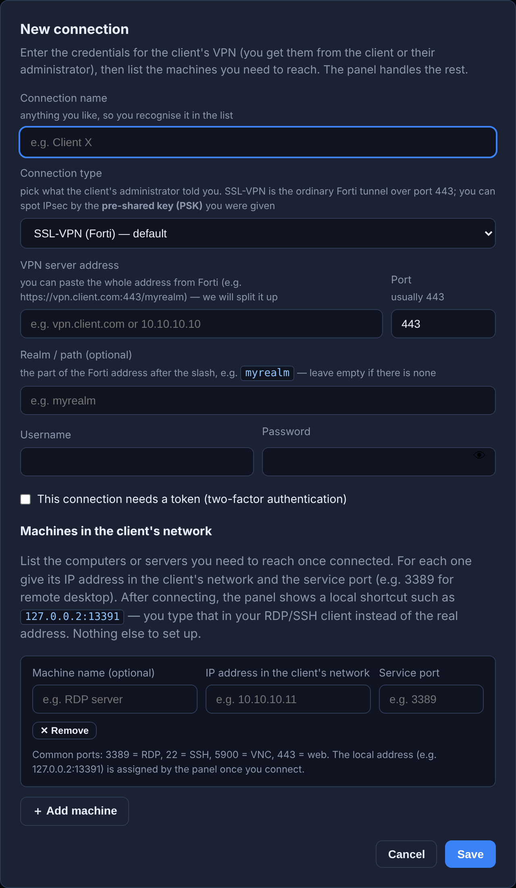

The same form filled in with example data:

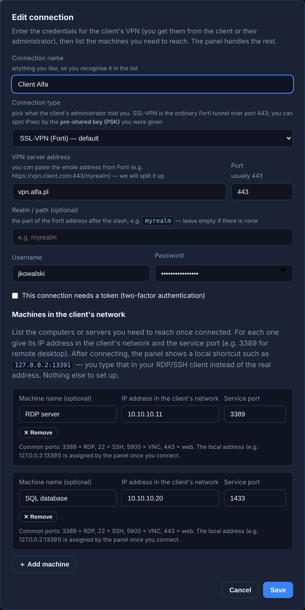

### VPN fields

| Field | What to type |
|---|---|
| **Connection name** | Any description that helps you recognise it in the list, e.g. "Client Alfa". |
| **Connection type** | **SSL-VPN (Forti)** — leave this if you are unsure; most gateways work this way. **IPsec** — choose it if the client gave you a **pre-shared key (PSK)**. The choice changes the fields below. |
| **VPN server address** | The client's VPN gateway, e.g. `vpn.alfa.com` or `10.10.10.10`. You can also paste the full address from Forti (e.g. `https://vpn.client.com:443/myrealm`) — the panel splits it into address, port and realm by itself. |
| **Port** | Usually `443` (leave the default unless the client says otherwise). |
| **Realm / path** (optional) | The part of the Forti address after the slash, e.g. `myrealm`. Leave empty if the gateway address has none. |
| **Username** | Your user name for the client's VPN. |
| **Password** | The VPN password. The 👁 icon shows what you typed. |
| **This connection needs a token** | Tick this if the client's VPN uses two-factor authentication. Then pick how: **"I type a one-time code"** (from SMS or an app — the panel asks for the code when connecting) or **"I approve the sign-in in a phone app (push)"** (you get a notification on your phone and tap "Approve"). |

### An IPsec connection

If you set **Connection type** to **IPsec**, the "Port" and "Realm" fields disappear
(IPsec does not use them) and the ones below show up. You get all of this from the
client's administrator.

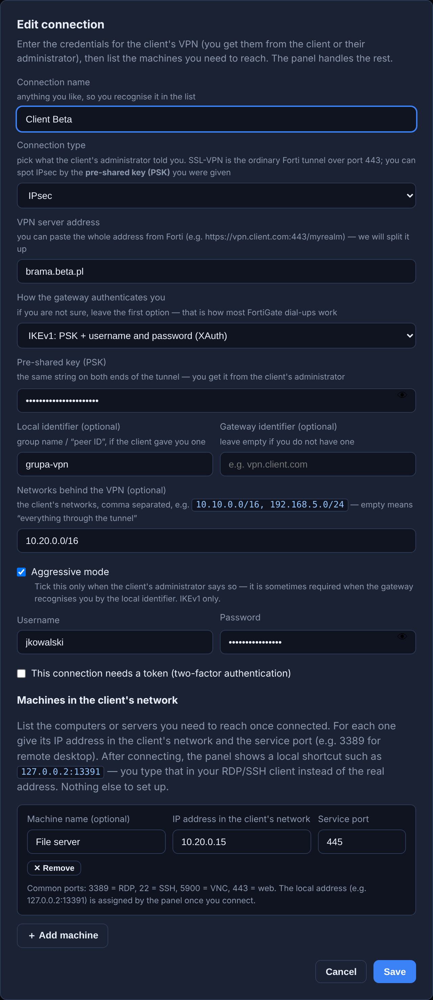

| Field | What to type |
|---|---|
| **How the gateway authenticates you** | If you do not know — leave the first option, **"IKEv1: PSK + username and password (XAuth)"**. That is how a typical FortiGate dial-up works and how FortiClient connects. Pick the other variants (**IKEv1 / IKEv2 with PSK only**) only when the client explicitly says so — the username and password fields then disappear, because the gateway asks for no user. |
| **Pre-shared key (PSK)** | The same string on both ends of the tunnel. Required — without it IPsec will not connect. The 👁 icon shows the key you typed. |
| **Local identifier** (optional) | The group name / "peer ID", if the client gave you one. Leave empty if you have none. |
| **Gateway identifier** (optional) | The identifier the gateway presents itself with. Usually empty. |
| **Networks behind the VPN** (optional) | The client's networks, comma separated, e.g. `10.10.0.0/16, 192.168.5.0/24`. Empty means "everything through the tunnel" and is usually fine. |
| **Aggressive mode** | Tick this **only** when the client's administrator says so. It is sometimes required when the gateway recognises you by the local identifier. IKEv1 only. |

The address inside the client's network is assigned by the gateway itself — you do not
type it anywhere.

> **A token with IPsec.** If the connection needs a token, choose **"I type a one-time
> code"**. The panel appends the code to the password, exactly as FortiClient does with
> XAuth. Approval on a phone (push) only works with SSL-VPN — with IPsec that option is
> hidden.

### Machines in the client's network

These are the computers or servers behind the VPN you want to reach. For each one click
**＋ Add machine** and fill in:

| Field | What to type |
|---|---|
| **Machine name** (optional) | A description, e.g. "RDP server" — purely for your convenience. If you type a service name (RDP, SSH, VNC…), **the service port fills itself in**. |
| **IP address in the client's network** | The machine's address in the client's network, e.g. `10.10.10.11`. |
| **Service port** | The port of the service you use — see the table below. The field takes numbers from 1 to 65535 only. |

**The most common service ports:**

| Port | Service |
|---|---|
| `3389` | Remote desktop (RDP) |
| `22` | SSH |
| `5900` | VNC |
| `443` | Web page (HTTPS) |

You do not set a "local port" — the panel assigns one from a reserved pool and shows the
finished address once you connect.

Finally, click **Save**.

---

## 7. Step 5 — connect

On the connection card, click the green **Connect** button.

- If you chose **a one-time code**, the panel asks for it in a dialog:

  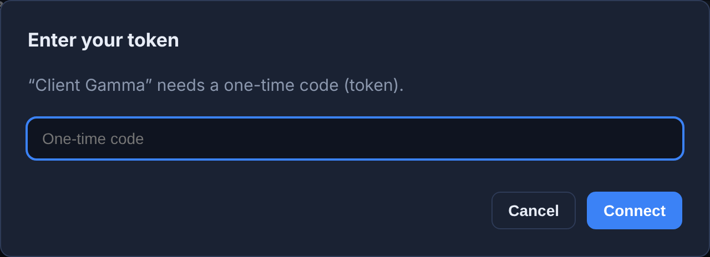

  Type the current code (from SMS or an app) and click **Connect**.

- If you chose **approval in an app (push)**, you type nothing — a notification arrives on
  your phone and you approve it there. The panel waits and connects once you do.

---

## 8. Step 6 — unknown certificate

The **first** time you connect to a given VPN server, the panel usually shows the status
**"Unknown certificate"**. That is normal — the server presents its certificate and the
panel is seeing it for the first time.

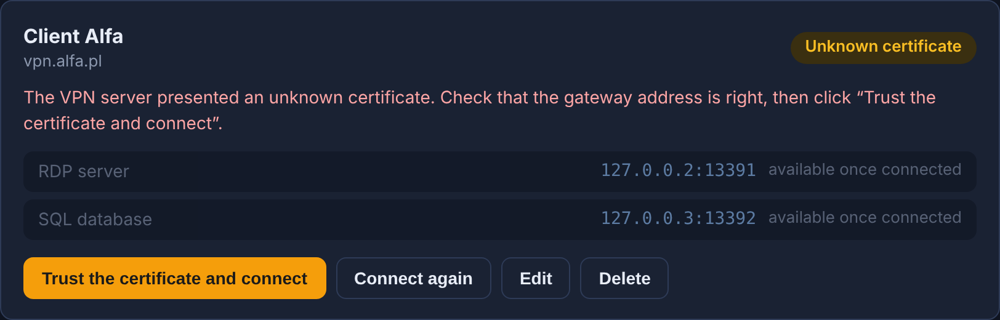

- Click **Trust the certificate and connect** — the panel remembers the certificate and
  connects. On later connections this step does not appear again.
- The **Connect again** button lets you retry from scratch (e.g. after fixing your
  credentials).

> The old version made you copy the certificate hash by hand and encrypt files. Now it is
> one click.

---

## 9. Step 7 — use the connection

Once connected, the status turns green — **"Connected"** — and every machine shows a local
address plus an action menu **⋮** (three dots):

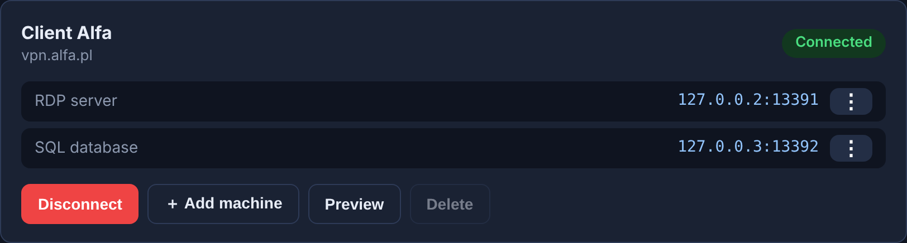

Click **⋮** next to a machine and the panel offers the action that fits the service:

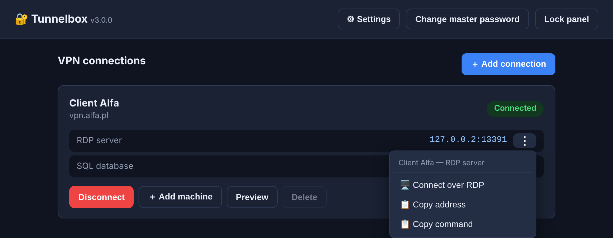

- **Connect over RDP** — opens remote desktop immediately (works with no setup, see
  below). With that option turned off in ⚙ Settings you get **Download .rdp file** instead.
- **Connect over SSH / VNC** — opens your SSH/VNC client (if you have one installed).
- **Open in browser** — for web services.
- **Copy address** — copies the machine's address to paste into any client.
- **Copy command** — a ready-made command, e.g. `mstsc /v:127.0.0.2:13391`.

The panel picks the action from the machine name **or** the service port — if the name
contains `https` (or `http`, `RDP`, `SSH`, `VNC`), the right action shows up even on an
unusual port such as `9443`.

You can always just copy the machine's address and type it into your RDP/SSH/VNC client
instead of the machine's real IP.

> 💡 **Every machine gets its own address** — the first `127.0.0.2`, the second
> `127.0.0.3` and so on. This is deliberate: Windows remembers a remote desktop password
> per address, but **does not distinguish ports**. If every machine sat under one shared
> `localhost`, each new sign-in would overwrite the previous machine's saved password.
> With separate addresses you tick "Remember me" once per machine and that is it.

### Fast RDP connect

Clicking **"Connect over RDP"** opens remote desktop immediately — **there is nothing to
turn on**. It is configured automatically when the program is started through `start.bat`.

What you get:
- **no clicking on every connection** — remote desktop starts straight at the machine's
  address, so Windows does not ask about a connection "from an unknown publisher",
- **the clipboard and printers work immediately** — they come from your own remote desktop
  settings instead of waiting to be approved on every start,
- **nothing lands in Downloads** — no file is written to disk,
- your saved password stays — Windows keeps it separately per machine address.

> 💡 **A change from older versions.** The panel used to save a `.rdp` file and open that.
> Since the April 2026 Windows update, every opening of an unsigned `.rdp` file shows an
> "unknown publisher" warning — with no "do not ask again" — and disables the clipboard for
> that session. That is why the panel now connects straight by address.

The first time you click, your browser asks whether to open the application — tick
**"Always allow"** and confirm. The setting applies to your Windows account only and needs
no administrator rights.

If nothing opens after the click (e.g. the panel was started without `start.bat`), the
panel notices and shows a hint with a **"⬇️ Download .rdp file"** button — you connect
right away, and fix fast connect by running `start.bat` again.

Prefer downloading the file by hand? In the header click **⚙ Settings** and turn off
**"Fast RDP connect"** — the ⋮ menu then offers **"⬇️ Download .rdp file"** instead of
"Connect over RDP". Switching takes effect at once; there is nothing to install or
uninstall.

### Adding a machine without disconnecting

On a **connected** profile the card carries a **"＋ Add machine"** button. You give the
name, IP address and port — the machine is added to the connection and made available
right away, **without dropping the VPN and signing in again**. The local port is assigned
automatically, and the new row with its ⋮ menu appears on the card within a second.

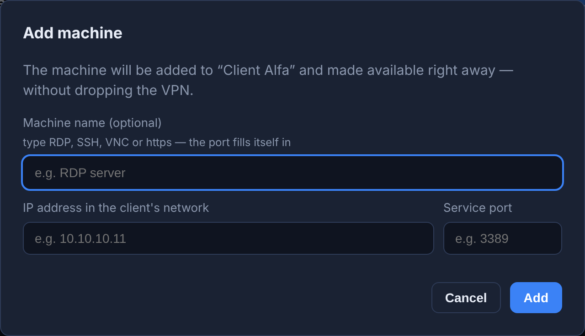

---

## 10. Several connections at once

You can have several connections up at the same time — even to clients whose networks use
identical IP ranges. Each runs in its own isolated network namespace, so they never mix.

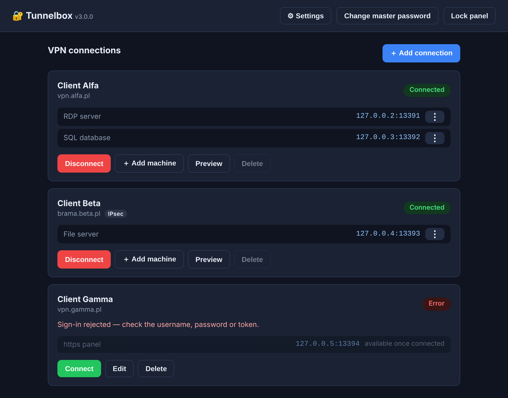

The list shows each connection's status (Connected / Disconnected / Error) and its machines.

---

## 11. Disconnecting and locking the panel

- **Disconnect** — ends that VPN connection (the red button on the card).
- **Lock panel** (top right) — closes access to the configuration; getting back in needs
  the master password. **Active VPN connections keep running** — the lock protects your
  data, it does not tear down tunnels. Worth doing when you step away from the computer;
  the browser's back button does not get around it.
- **Preview / Edit** — while a connection is **active**, the "Edit" button turns into
  "Preview": you see the settings without disconnecting, but read-only. To change anything
  or delete the connection, disconnect it first.

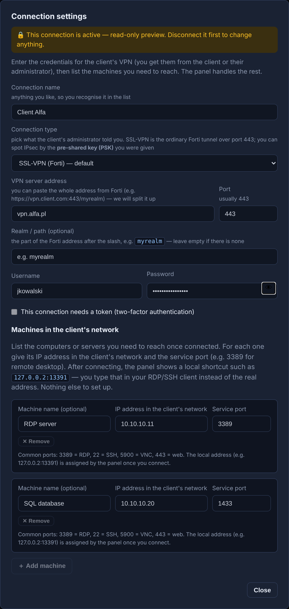

---

## 12. Panel settings

The **⚙ Settings** button in the top right opens one window with everything the panel lets
you change:

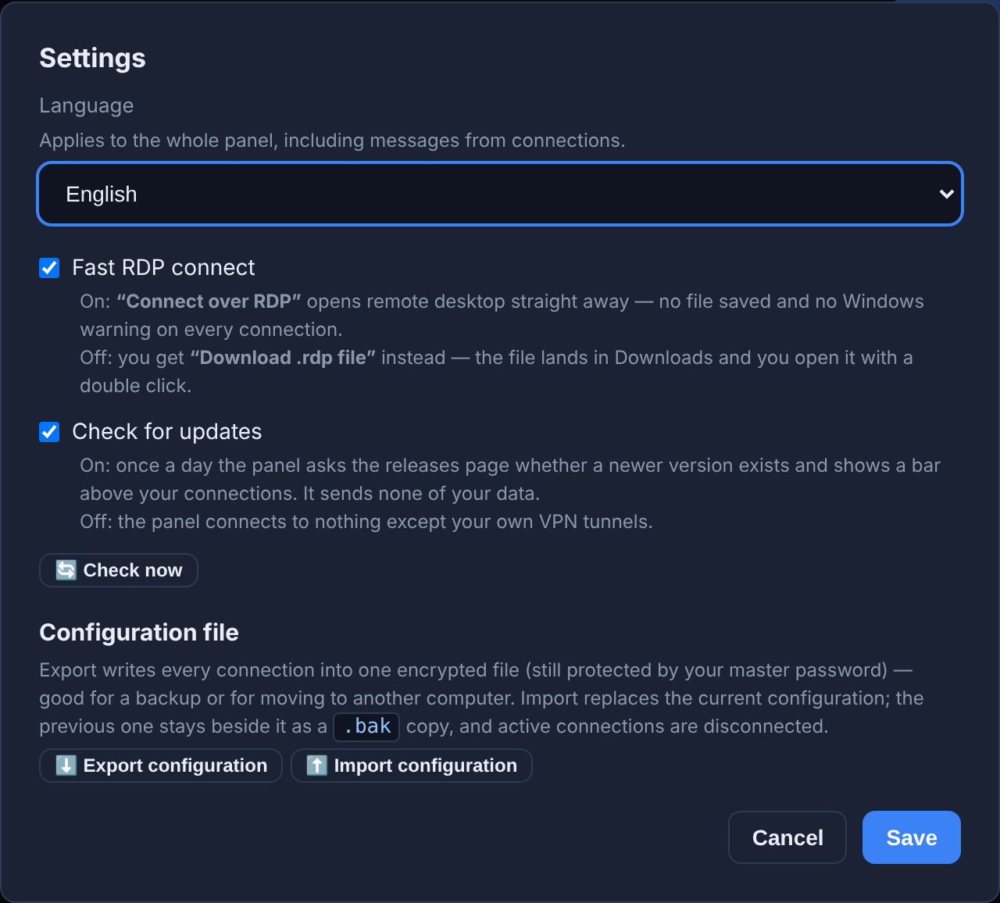

- **Language** — English (the default) or Polish. The change takes effect immediately,
  without reloading the page, and covers the whole panel including connection messages.
  The choice travels inside your encrypted configuration, so it comes back after moving to
  another computer.
- **Fast RDP connect** — on (default): "Connect over RDP" opens remote desktop straight
  away. Off: the ⋮ menu offers "⬇️ Download .rdp file" instead. Details in
  [step 7](#9-step-7--use-the-connection).
- **Check for updates** — once a day the panel asks the releases page whether a newer
  version exists. Off means the panel connects to nothing except your own VPN tunnels.
  Next to it there is a **"🔄 Check now"** button for a one-off check. More in
  [Updates](#15-updates).
- **⬇️ Export configuration** — writes every connection into a single `.enc` file, **still
  encrypted with your master password**. Good for a backup or for moving the panel to
  another computer. The same button is on the sign-in screen, so you can make a copy
  without even unlocking the vault.
- **⬆️ Import configuration** — reads such a file back; you give the master password that
  protected it. Import **replaces** the current configuration (the previous one stays
  beside it as a `.bak` copy) and drops active connections.

The switches are saved with the **Save** button. Export and import act immediately —
there is nothing to confirm.

---

## 13. Statuses and troubleshooting

| Status | What it means / what to do |
|---|---|
| 🟢 **Connected** | Everything works, you can use the machine addresses (`127.0.0.X:PORT`). |
| ⚪ **Disconnected** | The connection is not active. Click "Connect". |
| 🟡 **Connecting…** | The tunnel is being established — give it a moment. |
| 🟡 **Unknown certificate** | Click "Trust the certificate and connect" (see step 6). |
| 🔴 **Error** | A description of the problem appears under the status. Most often: |

The most common error messages:

| Message | Cause | What to do |
|---|---|---|
| "Sign-in rejected…" | Wrong username, password or token | Fix the credentials (Edit) or supply a fresh token. |
| "Cannot reach the VPN server…" | Wrong server address or no internet | Check the server address and your network connection. |
| "…port forwarding failed" | Wrong machine IP or port | Check the machine's IP address and service port. |
| "not working — check the IP and port" (red) | The machine is unreachable in the client's network | Check that the machine is switched on and the address is right. |
| "This Docker environment does not provide PPP…" | Docker without PPP support (more common on a Mac) | Update Docker Desktop. |

Messages you only see with **IPsec** connections:

| Message | Cause | What to do |
|---|---|---|
| "The gateway is not answering…" | Wrong gateway address, or the network blocks IPsec | Check the address. IPsec needs UDP ports 500 and 4500 — some networks (hotels, guest Wi-Fi) block them. |
| "The server rejected the PSK or the identifier…" | Wrong pre-shared key or a missing local identifier | Check the key character by character; ask for the group name / "peer ID" and about aggressive mode. |
| "The server accepted none of the cipher sets…" | The gateway uses unusual algorithms | Ask the administrator for the phase 1 and phase 2 algorithms. |
| "The server rejected the network range…" | Too wide or wrong entry in "Networks behind the VPN" | Enter exactly the networks the client gave you, or clear the field. |
| "The kernel does not provide IPsec (XFRM)…" | Docker Desktop is too old | Update Docker Desktop; failing that, use SSL-VPN. |
| "The IPsec tunnel was dropped." | The gateway closed the tunnel and it could not be re-established | Connect again; if it repeats every few minutes, ask about the gateway's timeouts. |

For the technical details, click **"Show connection log"** on the card.

If the panel does not open at all:
- Check that Docker Desktop is running and start `start.bat` again.
- Look at the logs: run `docker compose logs` in the program folder.

---

## 14. Security and backup

- **Where is the data?** In the `vault.enc` file in `%LOCALAPPDATA%\Tunnelbox\data`
  (Mac/Linux: `~/.local/share/tunnelbox/data`), encrypted with your master password
  (AES-256-GCM). That single file holds all your connections. It lives outside the program
  folder so that updating never loses it.
- **Changing the master password** — the **"Change master password"** button in the top
  right. You give the current password and a new one; the vault is re-encrypted and your
  saved connections are kept.
- **Backup** — **⚙ Settings → "⬇️ Export configuration"**, described in
  [Panel settings](#12-panel-settings). The manual equivalent: copying the file
  `%LOCALAPPDATA%\Tunnelbox\data\vault.enc`.
- **Local access only** — the panel and the forwarded ports listen on `127.0.0.1` (your
  computer) exclusively. Nobody on the network can reach them.
- **Stopping the program** — run `docker compose down` in the program folder.
- **Updating** — see [Updates](#15-updates). In short: the bar above the connection list,
  or downloading a newer package and running `start.bat`. Either way your master password,
  profiles and panel settings are kept.

---

## 15. Updates

Once a day the panel checks whether a newer version exists. When there is one, a bar
appears above the connection list with the version number, release date and package size:

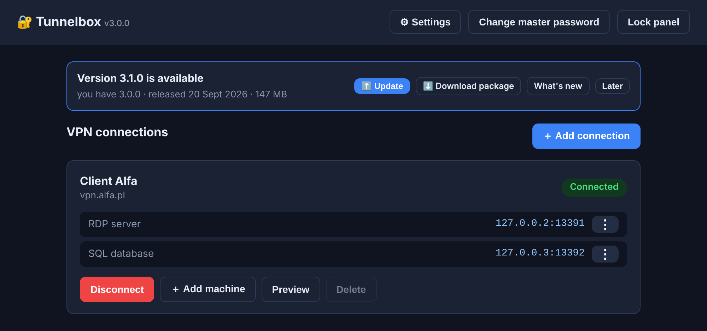

- **⬆️ Update** *(Windows)* — downloads the package, unpacks and installs it. The progress
  shows in a separate window; the panel disappears for a moment and opens again by itself.
  Your saved connections, master password and settings are untouched.
- **⬇️ Download package** — saves the ZIP to Downloads. Unpack it anywhere and run
  `start.bat` — from there everything happens exactly the same way.
- **What's new** — opens the project page with the release notes.
- **Later** — hides the bar until you close the browser. The next version brings it back.

If nothing opens after clicking "Update", the panel notices and tells you: one-click
updates need the panel to be started through `start.bat` — that is what registers the
installer with the system. Downloading the package always works.

**Coming from FortiVPN 2?** It does not update to Tunnelbox: install Tunnelbox from scratch
and bring your connections along with an export, as described in
[Installing and starting](#2-installing-and-starting).

**Installed from the registry** (with `docker compose`)? Then instead of "⬆️ Update" and
"⬇️ Download package" the bar shows the two commands to run, one after the other, in the
folder with `docker-compose.yml`: `docker compose pull`, then `docker compose up -d`.

**Do not want the check?** ⚙ **Settings → Check for updates** (see
[Panel settings](#12-panel-settings)). Off means the panel connects to nothing except your
own VPN tunnels. Next to it there is a **"🔄 Check now"** button for a one-off check.

The check sends none of your data — the panel only asks for the list of the program's
releases. When there is no internet or the page does not answer, the bar simply does not
appear and the panel carries on.

**After updating from the panel**, the folder you once unpacked the old package into stays
on disk — you can delete it. If you were to run `start.bat` from there, the program asks
for confirmation before going back to an older version.
