# Tunnelbox — instrukcja obsługi

*[🇬🇧 English](MANUAL.md) · 🇵🇱 Polski*

Kompletny przewodnik krok po kroku, ze zrzutami ekranu. Nie musisz znać się na
sieciach ani konsoli — wszystko klikasz w przeglądarce.

**Co robi ten program?** Łączy Cię z siecią klienta przez VPN Fortinet (SSL-VPN
albo IPsec) i tworzy lokalne „skróty" do maszyn w tej sieci. Zamiast prawdziwego
adresu (np. `10.10.10.11`) wpisujesz w kliencie pulpitu zdalnego / SSH prosty adres
typu `127.0.0.2:13391`. Cały VPN działa w tle, w izolowanym kontenerze Docker — Twój
komputer nie zostaje wpięty do sieci klienta.

Tunnelbox to nowa nazwa programu FortiVPN 2 (od wersji 3.0.0). Program nie jest powiązany
z firmą Fortinet ani przez nią popierany.

---

## Spis treści
1. [Co jest potrzebne](#1-co-jest-potrzebne)
2. [Instalacja i uruchomienie](#2-instalacja-i-uruchomienie)
3. [Krok 1 — ustaw hasło główne](#3-krok-1--ustaw-hasło-główne)
4. [Krok 2 — odblokuj panel](#4-krok-2--odblokuj-panel)
5. [Krok 3 — pusty panel](#5-krok-3--pusty-panel)
6. [Krok 4 — dodaj połączenie](#6-krok-4--dodaj-połączenie)
7. [Krok 5 — połącz się](#7-krok-5--połącz-się)
8. [Krok 6 — nieznany certyfikat](#8-krok-6--nieznany-certyfikat)
9. [Krok 7 — korzystaj z połączenia](#9-krok-7--korzystaj-z-połączenia)
10. [Kilka połączeń naraz](#10-kilka-połączeń-naraz)
11. [Rozłączanie i blokowanie panelu](#11-rozłączanie-i-blokowanie-panelu)
12. [Ustawienia panelu](#12-ustawienia-panelu)
13. [Statusy i rozwiązywanie problemów](#13-statusy-i-rozwiązywanie-problemów)
14. [Bezpieczeństwo i kopia zapasowa](#14-bezpieczeństwo-i-kopia-zapasowa)
15. [Aktualizacje](#15-aktualizacje)

---

## 1. Co jest potrzebne

- **Docker Desktop** — jedyny program, który musisz zainstalować.
  Pobierz z [docker.com](https://www.docker.com/products/docker-desktop/),
  zainstaluj i uruchom (poczekaj, aż ikonka wieloryba w zasobniku przestanie się
  animować). Na Linuksie wystarczy Docker Engine.
- Dane dostępowe do VPN klienta (adres serwera, login, hasło) — dostajesz je od
  klienta lub administratora.

Nie musisz instalować niczego więcej — żadnego Pythona, OpenSSL czy konsoli.

> 🌍 **Panel startuje po angielsku.** Polski włączysz w **⚙ Settings → Language →
> Polski** — dalsza część instrukcji pokazuje panel już po polsku. Wybór obejmuje
> cały interfejs, także komunikaty połączeń, i zapisuje się razem z konfiguracją
> (patrz [Ustawienia panelu](#12-ustawienia-panelu)).

---

## 2. Instalacja i uruchomienie

1. Pobierz najnowszą paczkę, **`tunnelbox-X.Y.Z.zip`**, ze
   [strony programu](https://mysttic.github.io/Mysttic/tunnelbox/) i rozpakuj ją
   w dowolnym folderze.
2. Upewnij się, że **Docker Desktop jest uruchomiony**.
3. W folderze programu kliknij dwukrotnie **`start.bat`** (Windows).
   Na Macu/Linuksie uruchom `./start.sh` — na Macu raz poprosi o hasło, żeby dodać
   lokalne adresy potrzebne panelowi (znikają po restarcie komputera, więc wtedy
   uruchom `./start.sh` ponownie).
4. Pierwsze uruchomienie wczytuje dołączony obraz do Dockera i może potrwać
   kilka minut (kolejne są już natychmiastowe — obraz jest w Dockerze). Nic nie
   jest budowane ani pobierane z internetu. Na koniec panel otworzy się sam
   w przeglądarce pod adresem **http://tunnelbox.localhost:25263**.

Panel działa w tle — nie musisz trzymać otwartego żadnego okna konsoli. Możesz
go w każdej chwili otworzyć ponownie, wpisując `tunnelbox.localhost:25263` w przeglądarce.

**Masz już FortiVPN 2?** Tunnelbox to jego nowa nazwa, ale instaluje się od nowa i nie
przejmuje FortiVPN 2. Żeby przenieść zapisane połączenia:

1. W FortiVPN 2: **⚙ Ustawienia → „⬇️ Eksportuj konfigurację"** (plik jest zaszyfrowany
   Twoim hasłem głównym).
2. Usuń kontener FortiVPN 2, który zajmuje port panelu: w Docker Desktop → **Containers**
   skasuj `fortivpn2-panel` (albo uruchom `docker rm -f fortivpn2-panel`).
3. Zainstaluj Tunnelbox jak wyżej.
4. Na pierwszym ekranie kliknij **„⬆️ Importuj"**, wybierz wyeksportowany plik i wpisz to
   samo hasło główne.

FortiVPN 2 już usunięty? Zaimportuj jego plik sejfu:
`%LOCALAPPDATA%\FortiVPN2\data\vault.enc` (Mac/Linux:
`~/.local/share/fortivpn2/data/vault.enc`). Gdy wszystko działa, usuń folder
`%LOCALAPPDATA%\FortiVPN2` (Mac/Linux: `~/.local/share/fortivpn2`) i stare obrazy
`fortivpn2-panel` w Docker Desktop → **Images**. Popraw też zakładkę w przeglądarce: panel
otwiera się teraz pod adresem **http://tunnelbox.localhost:25263**.

---

## 3. Krok 1 — ustaw hasło główne

Przy pierwszym uruchomieniu program poprosi o **hasło główne**. Tym jednym hasłem
szyfrowane są wszystkie Twoje połączenia (adresy, loginy, hasła VPN). Bez niego
nikt nie odczyta ich z dysku.

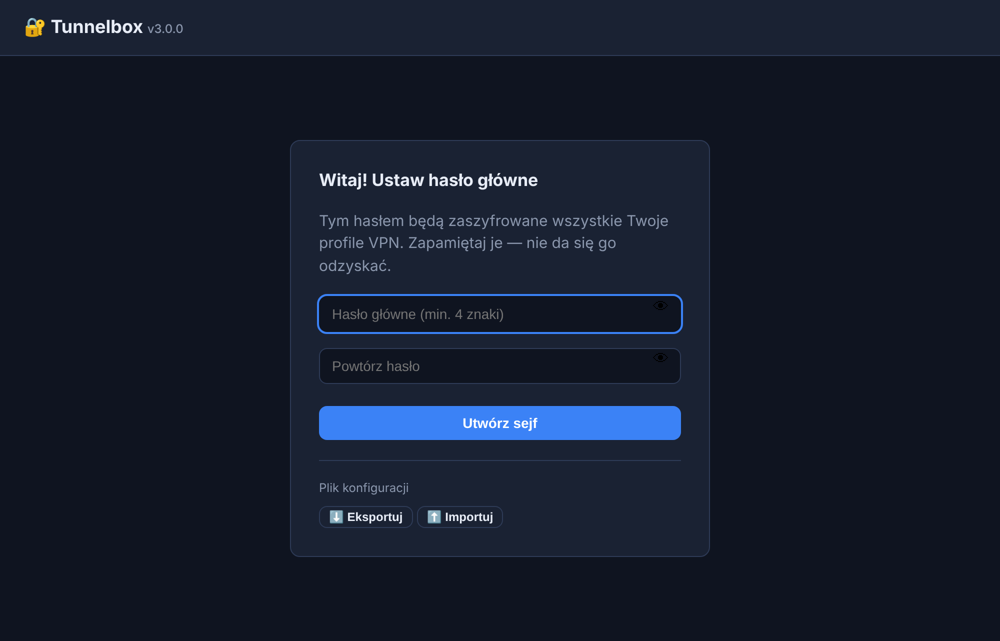

- Wpisz hasło (min. 4 znaki) i powtórz je w drugim polu.
- Klikasz **Utwórz sejf** — gotowe.
- Ikonka 👁 po prawej stronie pola pokazuje wpisywane hasło, żeby uniknąć
  literówki.

> ⚠️ **Zapamiętaj to hasło.** Nie da się go odzyskać ani zresetować. Jeśli je
> zapomnisz, jedynym wyjściem jest utworzenie sejfu od nowa (z utratą zapisanych
> połączeń).

---

## 4. Krok 2 — odblokuj panel

Przy każdym kolejnym otwarciu panelu (albo po kliknięciu „Zablokuj panel")
zobaczysz ekran odblokowania. Podaj hasło główne i kliknij **Odblokuj**.

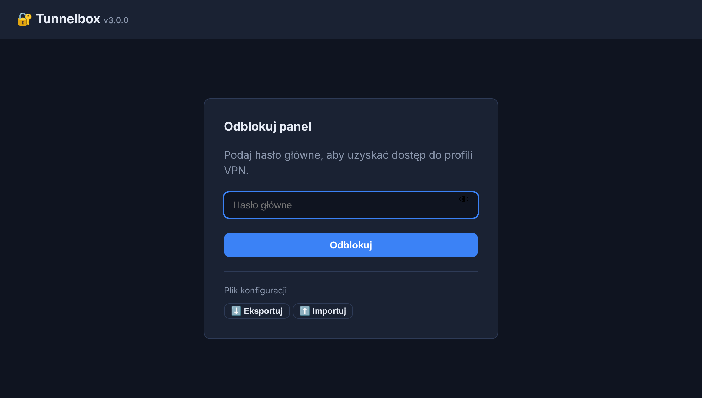

---

## 5. Krok 3 — pusty panel

Po odblokowaniu, gdy nie masz jeszcze żadnych połączeń, panel wygląda tak:

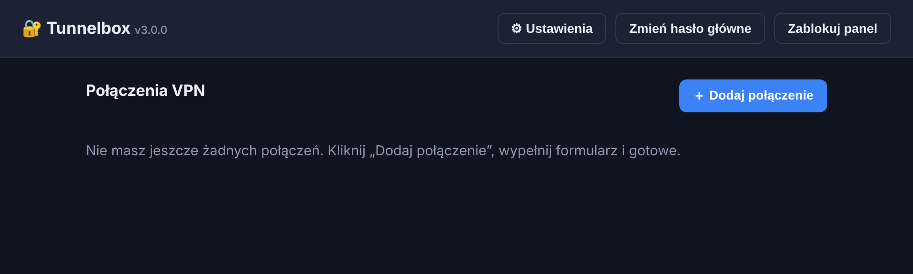

Kliknij **＋ Dodaj połączenie** w prawym górnym rogu, aby utworzyć pierwsze.

W nagłówku, obok nazwy programu, widnieje **numer zainstalowanej wersji** (np.
`v3.0.0`) — przyda się, gdy będziesz zgłaszać problem albo sprawdzać, czy masz
najnowszą ([Aktualizacje](#15-aktualizacje)). Po prawej są trzy przyciski:
**⚙ Ustawienia** ([sekcja 12](#12-ustawienia-panelu)), **Zmień hasło główne**
i **Zablokuj panel** ([sekcja 11](#11-rozłączanie-i-blokowanie-panelu)).

---

## 6. Krok 4 — dodaj połączenie

Otworzy się formularz. Na górze są dane logowania do VPN, a niżej lista maszyn,
do których chcesz się dostać.

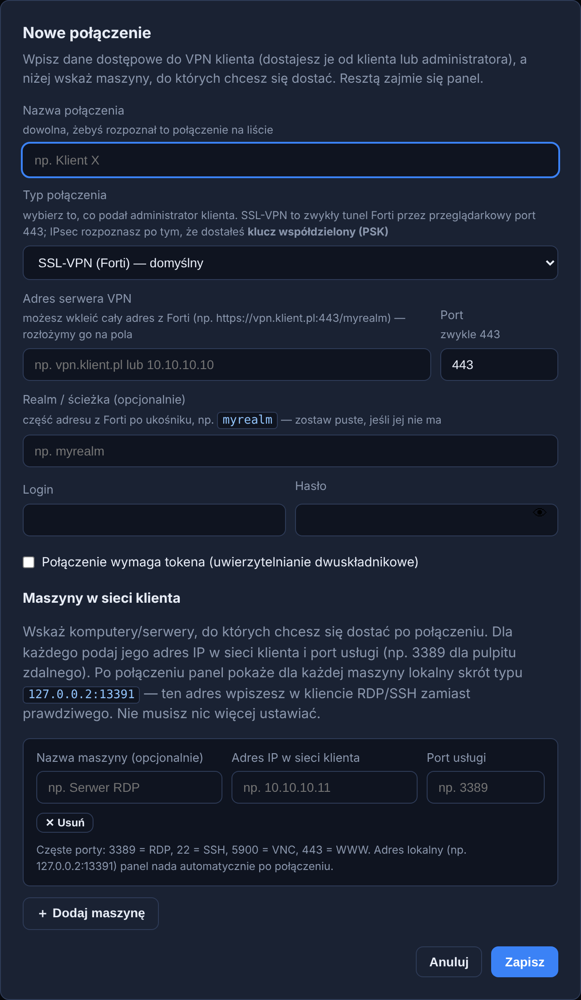

Poniżej ten sam formularz wypełniony przykładowymi danymi:

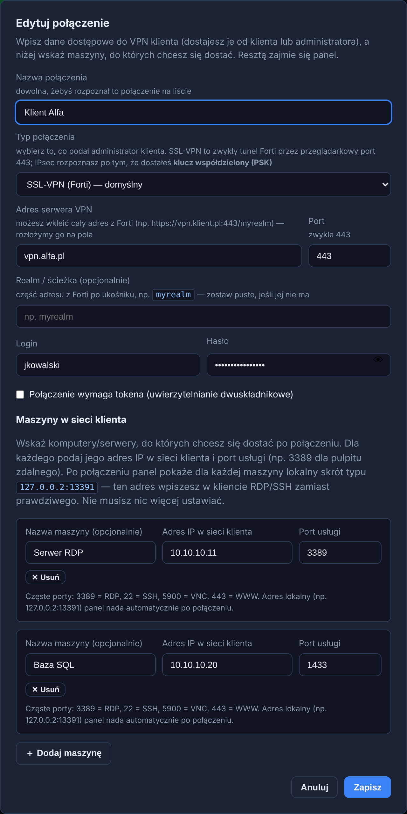

### Pola danych VPN

| Pole | Co wpisać |
|---|---|
| **Nazwa połączenia** | Dowolny opis, żebyś rozpoznał je na liście, np. „Klient Alfa". |
| **Typ połączenia** | **SSL-VPN (Forti)** — zostaw, jeśli nie wiesz; tak działa większość bram. **IPsec** — wybierz, jeśli klient podał Ci **klucz współdzielony (PSK)**. Wybór zmienia zestaw pól niżej. |
| **Adres serwera VPN** | Adres bramy VPN klienta, np. `vpn.alfa.pl` lub `10.10.10.10`. Możesz też wkleić cały adres z Forti (np. `https://vpn.klient.pl:443/myrealm`) — panel sam rozłoży go na adres, port i realm. |
| **Port** | Zwykle `443` (zostaw domyślne, chyba że klient poda inny). |
| **Realm / ścieżka** (opcjonalnie) | Część adresu z Forti po ukośniku, np. `myrealm`. Zostaw puste, jeśli adres bramy jej nie ma. |
| **Login** | Twoja nazwa użytkownika do VPN klienta. |
| **Hasło** | Hasło do VPN. Ikonka 👁 pokazuje wpisane hasło. |
| **Połączenie wymaga tokena** | Zaznacz, jeśli VPN klienta ma uwierzytelnianie dwuskładnikowe. Wybierz wtedy sposób: **„Wpisuję kod jednorazowy"** (z SMS-a/aplikacji — panel poprosi o kod przy łączeniu) albo **„Zatwierdzam logowanie w aplikacji (push)"** (dostaniesz powiadomienie na telefon i klikasz „Zatwierdź"). |

### Połączenie IPsec

Jeśli w polu **Typ połączenia** wybierzesz **IPsec**, znikną pola „Port" i „Realm"
(IPsec ich nie używa), a pojawią się poniższe. Wszystkie dane dostajesz od
administratora klienta.

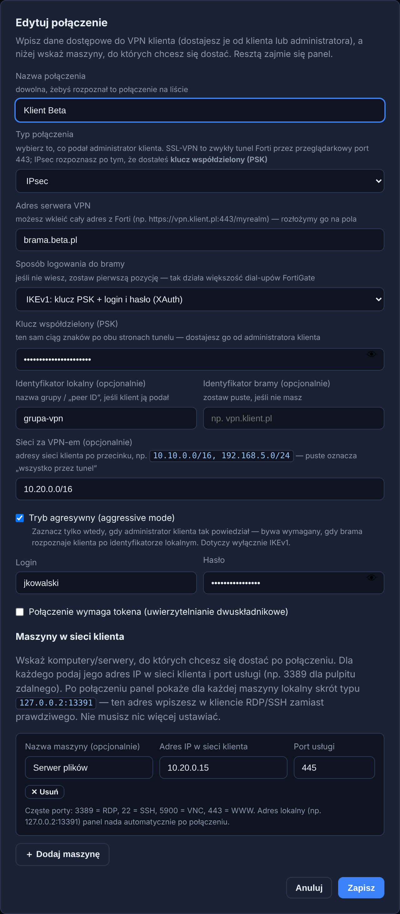

| Pole | Co wpisać |
|---|---|
| **Sposób logowania do bramy** | Jeśli nie wiesz — zostaw pierwszą pozycję, **„IKEv1: klucz PSK + login i hasło (XAuth)"**. Tak działa typowy dial-up FortiGate i tak łączy się FortiClient. Pozostałe warianty (**IKEv1 / IKEv2 na sam klucz PSK**) wybierz tylko wtedy, gdy klient wyraźnie tak powiedział — wtedy pola loginu i hasła znikają, bo brama nie pyta o użytkownika. |
| **Klucz współdzielony (PSK)** | Ten sam ciąg znaków po obu stronach tunelu. Pole obowiązkowe — bez niego IPsec się nie połączy. Ikonka 👁 pokazuje wpisany klucz. |
| **Identyfikator lokalny** (opcjonalnie) | Nazwa grupy / „peer ID", jeśli klient ją podał. Zostaw puste, jeśli nie masz. |
| **Identyfikator bramy** (opcjonalnie) | Identyfikator, którym przedstawia się brama. Zwykle puste. |
| **Sieci za VPN-em** (opcjonalnie) | Adresy sieci klienta po przecinku, np. `10.10.0.0/16, 192.168.5.0/24`. Puste znaczy „cały ruch przez tunel" i najczęściej jest w porządku. |
| **Tryb agresywny** | Zaznacz **tylko**, gdy administrator klienta tak powiedział. Bywa wymagany, gdy brama rozpoznaje klienta po identyfikatorze lokalnym. Dotyczy wyłącznie IKEv1. |

Adres w sieci klienta przydziela sama brama — nie musisz go nigdzie wpisywać.

> **Token przy IPsec.** Jeśli połączenie wymaga tokena, wybierz **„Wpisuję kod
> jednorazowy"**. Panel doklei kod do hasła, tak jak robi to FortiClient przy XAuth.
> Zatwierdzanie na telefonie (push) działa tylko przy SSL-VPN — przy IPsec ta opcja
> jest ukryta.

### Maszyny w sieci klienta

To komputery/serwery za VPN-em, z którymi chcesz się połączyć. Dla każdej maszyny
kliknij **＋ Dodaj maszynę** i wypełnij:

| Pole | Co wpisać |
|---|---|
| **Nazwa maszyny** (opcjonalnie) | Opis, np. „Serwer RDP" — tylko dla Twojej wygody. Jeśli wpiszesz nazwę usługi (RDP, SSH, VNC…), **port usługi uzupełni się sam**. |
| **Adres IP w sieci klienta** | Adres maszyny w sieci klienta, np. `10.10.10.11`. |
| **Port usługi** | Port usługi, z której korzystasz — patrz tabela niżej. Pole przyjmuje tylko liczby z zakresu 1–65535. |

**Najczęstsze porty usług:**

| Port | Usługa |
|---|---|
| `3389` | Pulpit zdalny (RDP) |
| `22` | SSH |
| `5900` | VNC |
| `443` | Strona WWW (HTTPS) |

Nie ustawiasz „portu lokalnego" — panel nadaje go automatycznie z zarezerwowanej
puli i pokaże gotowy adres po połączeniu.

Na koniec kliknij **Zapisz**.

---

## 7. Krok 5 — połącz się

Na karcie połączenia kliknij zielony przycisk **Połącz**.

- Jeśli wybrałeś **kod jednorazowy**, panel poprosi o niego w okienku:

  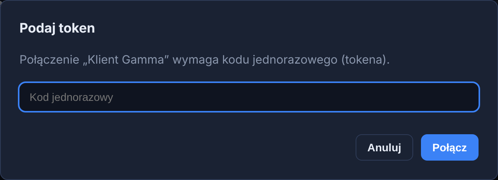

  Wpisz aktualny kod (z SMS-a lub aplikacji) i kliknij **Połącz**.

- Jeśli wybrałeś **zatwierdzenie w aplikacji (push)**, nic nie wpisujesz — na
  telefon przyjdzie powiadomienie, które musisz zatwierdzić. Panel poczeka i
  połączy się po akceptacji.

---

## 8. Krok 6 — nieznany certyfikat

Przy **pierwszym** łączeniu z danym serwerem VPN panel zwykle pokazuje status
**„Nieznany certyfikat"**. To normalne — serwer przedstawia swój certyfikat, który
panel widzi po raz pierwszy.

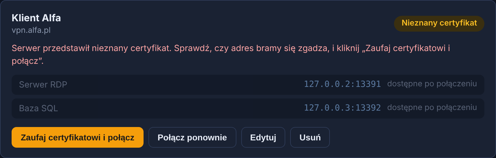

- Kliknij **Zaufaj certyfikatowi i połącz** — panel zapamięta certyfikat i połączy
  się. Przy kolejnych łączeniach ten krok już się nie pojawi.
- Przyciskiem **Połącz ponownie** możesz spróbować od nowa (np. po poprawieniu
  danych).

> W starej wersji trzeba było ręcznie kopiować kod certyfikatu i szyfrować pliki.
> Teraz to jedno kliknięcie.

---

## 9. Krok 7 — korzystaj z połączenia

Po udanym połączeniu status zmienia się na zielony **„Połączony"**, a przy każdej
maszynie pojawia się lokalny adres oraz menu akcji **⋮** (trzy kropki):

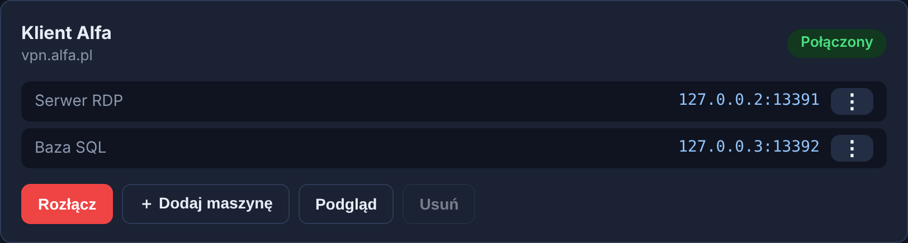

Kliknij **⋮** obok maszyny — panel podpowie akcję dopasowaną do usługi:

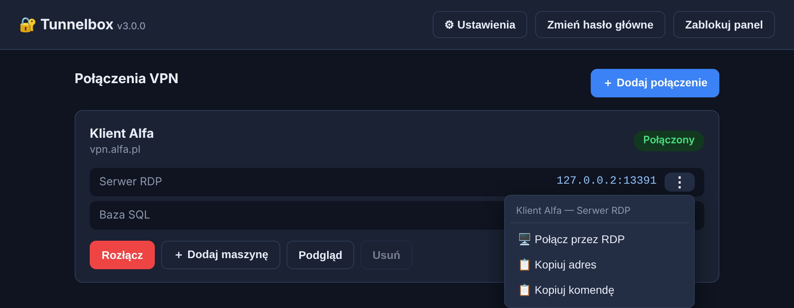

- **Połącz przez RDP** — od razu otwiera pulpit zdalny (działa bez konfiguracji,
  patrz niżej). Po wyłączeniu tej opcji w ⚙ Ustawieniach zamiast niego pojawi się
  **Pobierz plik .rdp**.
- **Połącz przez SSH / VNC** — otwiera Twojego klienta SSH/VNC (jeśli zainstalowany).
- **Otwórz w przeglądarce** — dla usług WWW.
- **Kopiuj adres** — kopiuje adres maszyny do wklejenia w dowolnym kliencie.
- **Kopiuj komendę** — gotowe polecenie, np. `mstsc /v:127.0.0.2:13391`.

Panel dobiera akcję po nazwie maszyny **lub** porcie usługi — jeśli w nazwie
wpiszesz `https` (albo `http`, `RDP`, `SSH`, `VNC`), właściwa akcja pojawi się nawet
przy nietypowym porcie, np. `9443`.

Zawsze możesz też po prostu skopiować adres maszyny i wpisać go ręcznie
w kliencie RDP/SSH/VNC zamiast prawdziwego IP maszyny.

> 💡 **Każda maszyna ma własny adres** — pierwsza `127.0.0.2`, druga `127.0.0.3`
> i tak dalej. To celowe: Windows zapamiętuje hasło do pulpitu zdalnego osobno
> dla każdego adresu, ale **nie rozróżnia portów**. Gdyby wszystkie maszyny
> siedziały pod jednym `localhost`, każde kolejne logowanie nadpisywałoby
> zapamiętane hasło poprzedniej maszyny. Dzięki osobnym adresom zaznaczasz
> „Zapamiętaj mnie" raz na maszynę i tyle.

### Szybkie łączenie RDP

Kliknięcie **„Połącz przez RDP"** od razu otwiera pulpit zdalny — **nie musisz nic
włączać**. Konfiguruje się to samo przy uruchamianiu programu przez `start.bat`.

Co to daje:
- **zero klikania przy każdym połączeniu** — pulpit zdalny startuje wprost adresem
  maszyny, więc Windows nie pyta o zgodę na „połączenie od nieznanego wydawcy",
- **schowek i drukarki działają od razu** — biorą się z Twoich ustawień pulpitu
  zdalnego, zamiast czekać na odklikanie przy każdym uruchomieniu,
- **nic nie ląduje w „Pobranych"** — żaden plik nie jest zapisywany na dysk,
- zapamiętane hasło zostaje — Windows trzyma je osobno dla każdego adresu maszyny.

> 💡 **Zmiana względem starszych wersji.** Wcześniej panel zapisywał plik `.rdp`
> i to jego otwierał. Od aktualizacji Windows z kwietnia 2026 każde otwarcie
> niepodpisanego pliku `.rdp` pokazuje ostrzeżenie „nieznany wydawca" — bez opcji
> „nie pytaj ponownie" — i wyłącza schowek na czas sesji. Dlatego panel łączy się
> teraz wprost adresem.

Przy pierwszym kliknięciu przeglądarka zapyta, czy otworzyć aplikację — zaznacz
**„Zawsze zezwalaj"** i potwierdź. Ustawienie dotyczy tylko Twojego konta Windows
i nie wymaga uprawnień administratora.

Gdyby po kliknięciu nic się nie otworzyło (np. panel uruchomiono bez `start.bat`),
panel sam to zauważy i pokaże podpowiedź z przyciskiem **„⬇️ Pobierz plik .rdp"** —
połączysz się od ręki, a szybkie łączenie naprawisz ponownym uruchomieniem `start.bat`.

Wolisz pobierać plik ręcznie? W nagłówku kliknij **⚙ Ustawienia** i wyłącz
**„Szybkie łączenie RDP"** — wtedy w menu ⋮ zamiast „Połącz przez RDP" pojawi się
**„⬇️ Pobierz plik .rdp"**. Przełączanie działa od ręki, nic nie trzeba instalować
ani odinstalowywać.

### Dodanie maszyny bez rozłączania

Przy **połączonym** profilu na karcie jest przycisk **„＋ Dodaj maszynę"**. Podajesz
nazwę, adres IP i port — maszyna zostaje dopisana do połączenia i udostępniona
od razu, **bez rozłączania VPN i ponownego logowania**. Port lokalny nadaje się
automatycznie, a nowy wiersz z menu ⋮ pojawia się na karcie w ciągu sekundy.

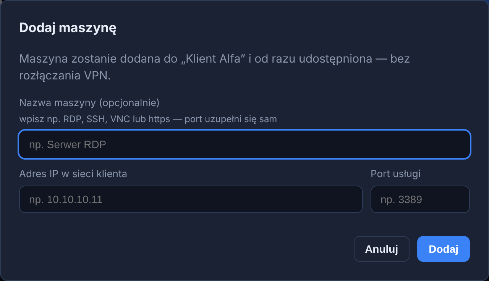

---

## 10. Kilka połączeń naraz

Możesz mieć kilka połączeń jednocześnie — nawet do klientów, których sieci mają
identyczne adresy IP. Każde działa w osobnej, izolowanej przestrzeni sieciowej, więc
się nie mieszają.

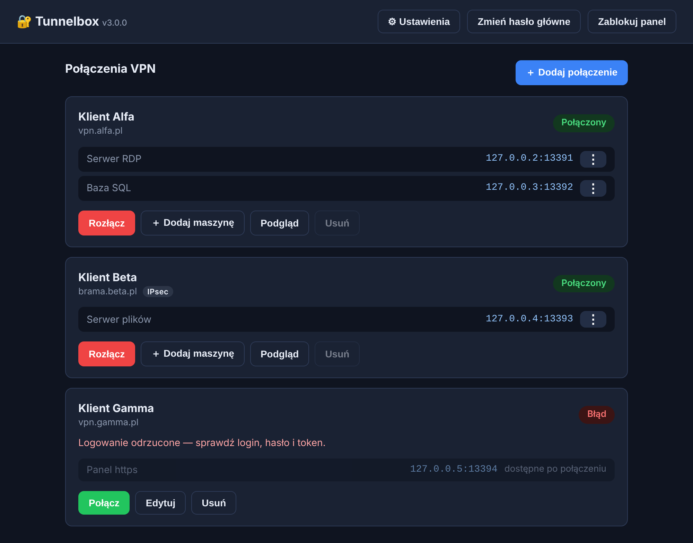

Na liście od razu widzisz status każdego połączenia (Połączony / Rozłączony / Błąd)
oraz jego maszyny.

---

## 11. Rozłączanie i blokowanie panelu

- **Rozłącz** — kończy dane połączenie VPN (czerwony przycisk na karcie).
- **Zablokuj panel** (prawy górny róg) — zamyka dostęp do konfiguracji; ponowne
  wejście wymaga hasła głównego. **Aktywne połączenia VPN działają dalej** — blokada
  chroni dane, nie zrywa tuneli. Warto zablokować, odchodząc od komputera; przycisk
  „wstecz" w przeglądarce nie pozwala tego obejść.
- **Podgląd / Edytuj** — przy **aktywnym** połączeniu przycisk „Edytuj" zmienia się
  w „Podgląd": zobaczysz ustawienia bez rozłączania, ale w trybie tylko-do-odczytu.
  Aby coś zmienić lub usunąć połączenie, najpierw je rozłącz.

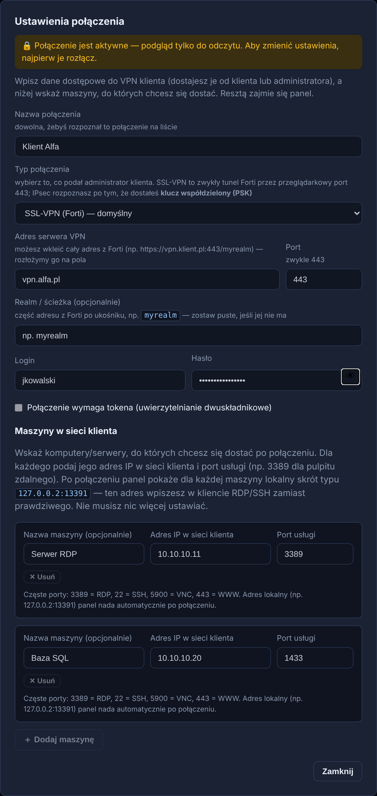

---

## 12. Ustawienia panelu

Przycisk **⚙ Ustawienia** w prawym górnym rogu otwiera jedno okno ze wszystkim,
co da się w panelu przestawić:

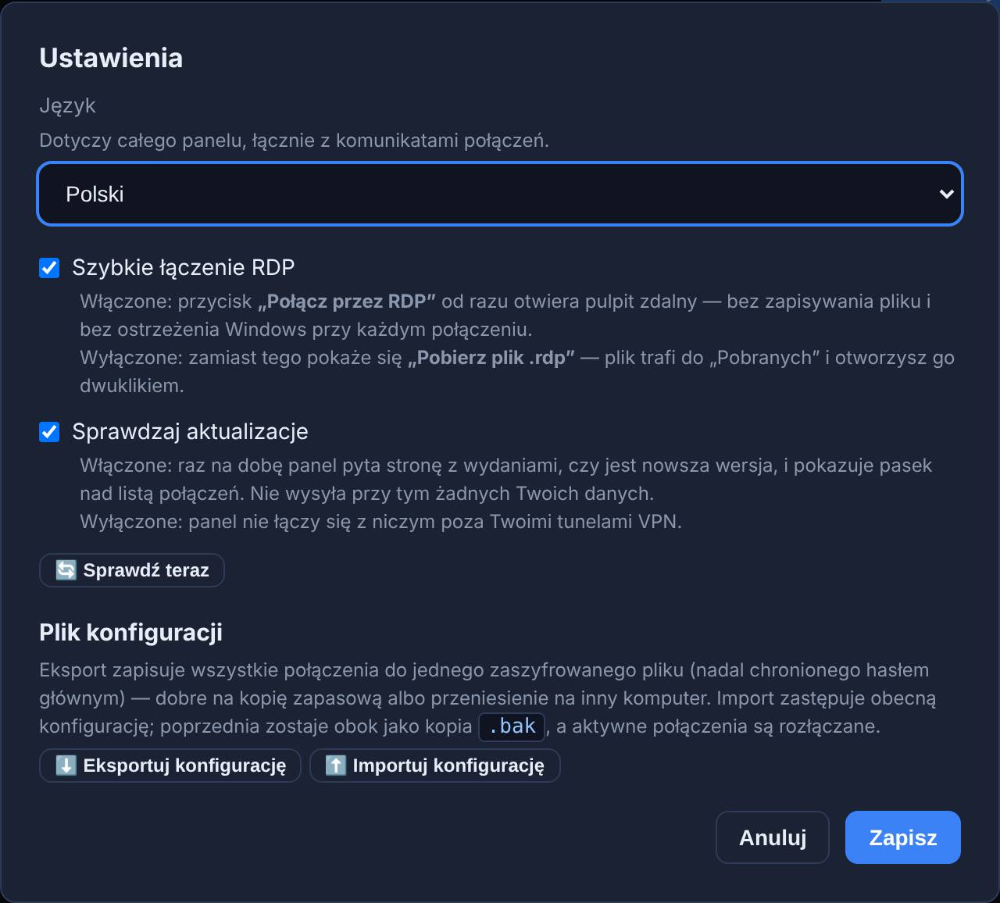

- **Język** — angielski (domyślnie) albo polski. Zmiana działa od razu, bez
  przeładowania strony, i obejmuje cały panel razem z komunikatami połączeń. Wybór
  jedzie w zaszyfrowanej konfiguracji, więc wraca po przeniesieniu na inny komputer.
- **Szybkie łączenie RDP** — włączone (domyślnie): „Połącz przez RDP" otwiera pulpit
  zdalny od razu. Wyłączone: w menu ⋮ pojawia się zamiast tego „⬇️ Pobierz plik .rdp".
  Szczegóły w [kroku 7](#9-krok-7--korzystaj-z-połączenia).
- **Sprawdzaj aktualizacje** — panel raz na dobę pyta stronę z wydaniami, czy jest
  nowsza wersja. Wyłączone znaczy, że panel nie łączy się z niczym poza Twoimi tunelami
  VPN. Obok jest przycisk **„🔄 Sprawdź teraz"** na jednorazowe sprawdzenie. Więcej
  w [Aktualizacjach](#15-aktualizacje).
- **⬇️ Eksportuj konfigurację** — zapisuje wszystkie połączenia do jednego pliku
  `.enc`, **nadal zaszyfrowanego hasłem głównym**. Dobre na kopię zapasową albo
  przeniesienie panelu na inny komputer. Ten sam przycisk jest na ekranie logowania,
  więc kopię zrobisz nawet bez odblokowywania sejfu.
- **⬆️ Importuj konfigurację** — wczytuje taki plik z powrotem; podajesz hasło główne,
  którym był chroniony. Import **zastępuje** obecną konfigurację (poprzednia zostaje
  obok jako kopia `.bak`), a aktywne połączenia są rozłączane.

Przełączniki zapisujesz przyciskiem **Zapisz**. Eksport i import działają od ręki —
nie trzeba niczego zatwierdzać.

---

## 13. Statusy i rozwiązywanie problemów

| Status | Znaczenie / co zrobić |
|---|---|
| 🟢 **Połączony** | Wszystko działa, możesz używać adresów maszyn (`127.0.0.X:PORT`). |
| ⚪ **Rozłączony** | Połączenie nieaktywne. Kliknij „Połącz". |
| 🟡 **Łączenie…** | Trwa zestawianie tunelu — poczekaj chwilę. |
| 🟡 **Nieznany certyfikat** | Kliknij „Zaufaj certyfikatowi i połącz" (patrz krok 6). |
| 🔴 **Błąd** | Pod statusem pojawia się opis problemu. Najczęściej: |

Najczęstsze komunikaty błędu:

| Komunikat | Przyczyna | Rozwiązanie |
|---|---|---|
| „Logowanie odrzucone…" | Zły login, hasło lub token | Popraw dane (Edytuj) albo podaj świeży token. |
| „Nie można połączyć się z serwerem VPN…" | Zły adres serwera lub brak internetu | Sprawdź adres serwera i połączenie z siecią. |
| „…przekierowania portów zawiodły" | Zły adres IP/port maszyny | Sprawdź adres IP i port usługi maszyny. |
| „przekierowanie nie działa" (czerwony) | Maszyna nieosiągalna w sieci klienta | Sprawdź, czy maszyna jest włączona i adres poprawny. |
| „Środowisko Docker nie udostępnia PPP…" | Docker bez wsparcia PPP (częściej na Macu) | Zaktualizuj Docker Desktop. |

Komunikaty spotykane tylko przy połączeniach **IPsec**:

| Komunikat | Przyczyna | Rozwiązanie |
|---|---|---|
| „Brama nie odpowiada…" | Zły adres bramy albo sieć blokuje IPsec | Sprawdź adres. IPsec potrzebuje portów UDP 500 i 4500 — w niektórych sieciach (hotele, gościnne Wi-Fi) bywają zablokowane. |
| „Serwer odrzucił klucz PSK lub identyfikator…" | Zły klucz współdzielony albo brakujący identyfikator lokalny | Sprawdź klucz znak po znaku; dopytaj o nazwę grupy / „peer ID" i o tryb agresywny. |
| „Serwer nie zaakceptował żadnego zestawu szyfrów…" | Brama używa nietypowych algorytmów | Poproś administratora o algorytmy fazy 1 i 2. |
| „Serwer odrzucił zakres sieci…" | Za szeroki lub zły wpis w „Sieci za VPN-em" | Wpisz dokładne sieci podane przez klienta albo wyczyść pole. |
| „Jądro nie udostępnia IPsec (XFRM)…" | Za stary Docker Desktop | Zaktualizuj Docker Desktop; w ostateczności użyj SSL-VPN. |
| „Tunel IPsec został zerwany." | Brama zamknęła tunel i nie udało się go odtworzyć | Połącz ponownie; jeśli powtarza się co kilka minut, dopytaj o limity czasu po stronie bramy. |

Szczegóły techniczne znajdziesz, klikając **„Pokaż log połączenia"** na karcie.

Jeśli panel w ogóle się nie otwiera:
- Sprawdź, czy Docker Desktop jest uruchomiony, i odpal `start.bat` ponownie.
- Podejrzyj logi: w folderze programu uruchom `docker compose logs`.

---

## 14. Bezpieczeństwo i kopia zapasowa

- **Gdzie są dane?** W pliku `vault.enc` w `%LOCALAPPDATA%\Tunnelbox\data`
  (Mac/Linux: `~/.local/share/tunnelbox/data`) — zaszyfrowanym hasłem głównym
  (AES-256-GCM). To jedyny plik z Twoimi połączeniami. Leży poza folderem programu, żeby
  aktualizacja go nie gubiła.
- **Zmiana hasła głównego** — przycisk **„Zmień hasło główne"** w prawym górnym
  rogu. Podajesz obecne hasło i nowe; sejf zostaje ponownie zaszyfrowany, a zapisane
  połączenia zachowane.
- **Kopia zapasowa** — **⚙ Ustawienia → „⬇️ Eksportuj konfigurację"**, opisane
  w [Ustawieniach panelu](#12-ustawienia-panelu). Ręczny odpowiednik: skopiowanie pliku
  `%LOCALAPPDATA%\Tunnelbox\data\vault.enc`.
- **Dostęp tylko lokalny** — panel i przekierowane porty słuchają wyłącznie na
  `127.0.0.1` (Twój komputer). Nikt z sieci nie ma do nich dostępu.
- **Zatrzymanie programu** — w folderze programu uruchom `docker compose down`.
- **Aktualizacja** — patrz [Aktualizacje](#15-aktualizacje). W skrócie: pasek nad
  listą połączeń albo pobranie nowszej paczki i `start.bat`. Hasło główne, profile
  i ustawienia panelu zostają w obu przypadkach.

---

## 15. Aktualizacje

Panel raz na dobę sprawdza, czy jest nowsza wersja. Gdy jest — nad listą połączeń
pojawia się pasek z numerem wersji, datą wydania i rozmiarem paczki:

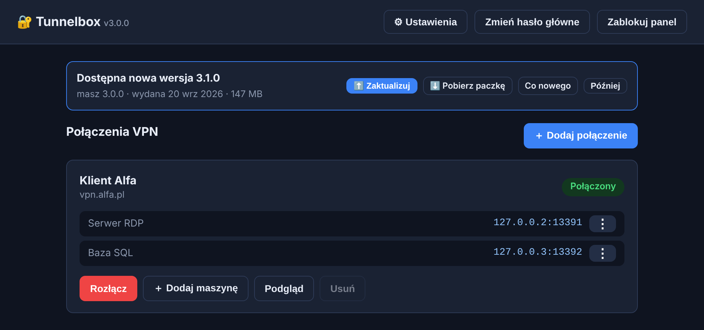

- **⬆️ Zaktualizuj** *(Windows)* — pobiera paczkę, rozpakowuje ją i instaluje.
  Postęp widać w osobnym oknie; panel na chwilę zniknie i otworzy się sam. Zapisane
  połączenia, hasło główne i ustawienia zostają nietknięte.
- **⬇️ Pobierz paczkę** — zapisuje ZIP do „Pobranych". Rozpakuj go gdziekolwiek
  i uruchom `start.bat` — dalej dzieje się dokładnie to samo.
- **Co nowego** — otwiera stronę programu z opisem wydania.
- **Później** — chowa pasek do zamknięcia przeglądarki. Kolejna wersja pokaże go znowu.

Jeśli po kliknięciu „Zaktualizuj" nic się nie otworzy, panel to zauważy i podpowie:
aktualizacja jednym kliknięciem wymaga, żeby panel był uruchamiany przez `start.bat`
— to on rejestruje instalator w systemie. Pobranie paczki działa zawsze.

**Masz FortiVPN 2?** Nie zaktualizuje się do Tunnelboksa: zainstaluj Tunnelbox od nowa
i przenieś połączenia eksportem, jak opisano w
[Instalacji i uruchomieniu](#2-instalacja-i-uruchomienie).

**Instalacja z rejestru** (przez `docker compose`)? Wtedy zamiast „⬆️ Zaktualizuj"
i „⬇️ Pobierz paczkę" pasek pokazuje dwa polecenia do uruchomienia po kolei w folderze
z `docker-compose.yml`: `docker compose pull`, a potem `docker compose up -d`.

**Nie chcesz sprawdzania?** ⚙ **Ustawienia → Sprawdzaj aktualizacje** (patrz
[Ustawienia panelu](#12-ustawienia-panelu)). Wyłączone oznacza, że panel nie łączy się
z niczym poza Twoimi tunelami VPN. Obok jest przycisk **„🔄 Sprawdź teraz"**, gdyby
przydało się sprawdzenie jednorazowe.

Sprawdzanie nie wysyła żadnych Twoich danych — panel pyta wyłącznie o listę wydań
programu. Gdy nie ma internetu albo strona nie odpowiada, paska po prostu nie ma,
a panel działa dalej.

**Po aktualizacji z panelu** folder, do którego kiedyś rozpakowałeś starą paczkę,
zostaje na dysku — można go usunąć. Gdyby uruchomić z niego `start.bat`, program
zapyta o potwierdzenie, zanim wróci do starszej wersji.
